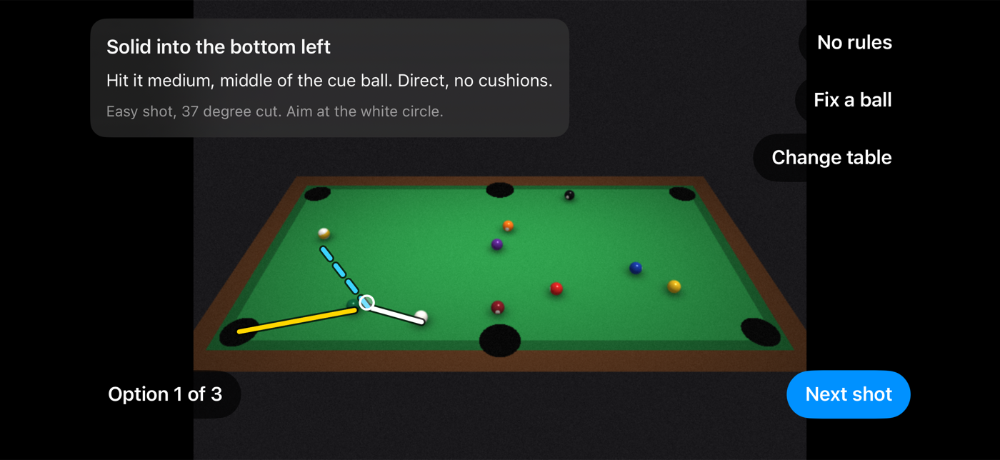
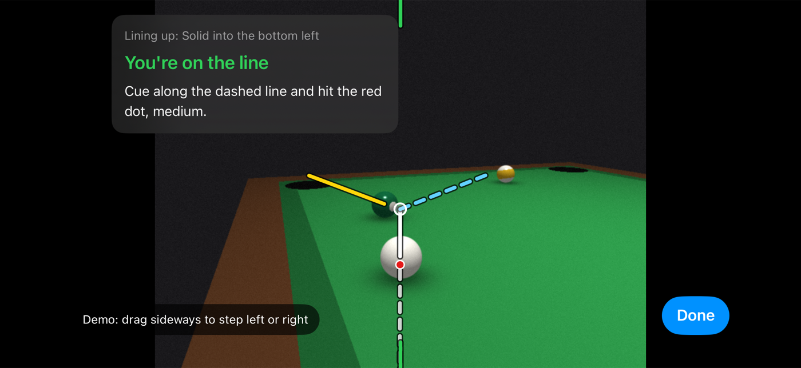

# CueSight

An iPhone app for pool and snooker. Point your phone at the table and it draws the shot on the camera picture: where the cue ball goes, where the object ball goes, where to aim, and how hard to hit.

CueSight is a working name.



## Status

The app works end to end in the iOS Simulator on a generated demo table, for pool and snooker. The ARKit camera code builds for a real iPhone but has never run on one, and nothing has been checked on a real table yet. Every accuracy number below comes from generated scenes on a Mac. See [docs/ROADMAP.md](docs/ROADMAP.md) for what's done and what's left.

## How it works

1. Pick your table size and tap its four corners on the camera picture.
2. Walk round the table while the app scans the balls.
3. Check the balls it found. Drag, add or remove any it got wrong.
4. Tap a ball, or let the rules pick, and see up to 3 shots with lines, a ghost ball to aim at, where to strike the cue ball, and how hard to hit.
5. Tap Line up, walk behind the cue ball and hold the phone low. The lines are drawn from your view, with a dashed line where your cue goes and a dot where to hit the cue ball. The app tells you to step left or right until you're on the line.



Everything runs on the phone. There's no server and no account, and camera frames are never saved or sent anywhere.

## Quick install

You need a Mac with Xcode 16 or newer. Nothing else.

```bash
git clone https://github.com/abozaralizadeh/CueSight.git
cd CueSight
open CueSight.xcodeproj
```

Pick the CueSight scheme and an iPhone Simulator, then press Run. In the Simulator the app uses a generated demo table in place of the camera. Add the launch argument `-demoCloth blue` or `-demoCloth red` to try another cloth colour.

To run on a real iPhone, set your own team under Signing and change the bundle id from the placeholder `com.example.cuesight`. ARKit needs a real iPhone, iOS 17 or newer.

The Xcode project is generated from `project.yml` with [XcodeGen](https://github.com/yonaskolb/XcodeGen). You only need XcodeGen if you change `project.yml`.

## Run the tests

```bash
cd CueSightKit
swift test
```

That's 93 tests and takes 3 to 4 minutes, most of it the generated-scene checks. The package runs on the Mac with no phone.

There are also command line checks:

```bash
# Ball finding accuracy on generated tables
swift run -c release cuesight-bench accuracy --table pool9 --scenes 10
swift run -c release cuesight-bench accuracy --table snooker12 --scenes 8

# Play the advised shots on a simulated table
swift run -c release cuesight-bench advice --table pool9

# The app's own scan loop on the demo table
swift run -c release cuesight-bench session --table pool8

# Compare a real scan with ruler measurements (both CSV: x_mm,y_mm)
swift run -c release cuesight-bench compare measured.csv truth.csv --table pool9

# Check the app has no networking and never saves camera images
../scripts/privacy_check.sh
```

If you use VS Code, `.vscode/tasks.json` has tasks for all of these.

## What's in here

| Folder | What it is |
| --- | --- |
| `App/` | The iPhone app (SwiftUI, landscape only) |
| `CueSightKit/Sources/ShotEngine` | Tables, pockets, rules and the shot finder. No camera code. |
| `CueSightKit/Sources/TableVision` | Table position from four corners, ball detection, colours, and combining frames |
| `CueSightKit/Sources/SceneSim` | Generated tables for testing, and a shot simulator that checks the advice |
| `CueSightKit/Sources/SessionCore` | The app flow, scan coverage, the review editor, the capped log and saved tables |
| `CueSightKit/Sources/cuesight-bench` | The command line checks above |
| `scripts/` | The app icon generator and the privacy check |
| `docs/` | Design, flows, roadmap and screenshots |
| `site/` | A one-page project site |

## Results so far (generated scenes only)

The pass marks: half the balls within 5 mm, 95% within 10 mm, 95% found.

| Check | Median error | 95% within | Found | False balls |
| --- | --- | --- | --- | --- |
| 9 ft pool, club light | 1.9 mm | 3.4 mm | 99.4% | 1 |
| 9 ft pool, dim light | 1.9 mm | 3.7 mm | 96.9% | 0 |
| 9 ft pool, uneven light | 2.1 mm | 4.2 mm | 97.7% | 0 |
| 9 ft pool, blue cloth | 1.8 mm | 3.1 mm | 99.0% | 0 |
| 9 ft pool, red cloth | 1.8 mm | 3.6 mm | **92.7%** | 0 |
| Full-size snooker | 1.9 mm | 3.3 mm | 98.9% | 3 |

Red cloth misses the mark because the maroon balls are close to the cloth colour. You can add them by hand on the review screen.

Advice played on the simulated table with a perfect stroke:

| Table | Potted, from measured positions | Potted, from true positions |
| --- | --- | --- |
| 9 ft pool | 100% | 100% |
| 8 ft pool | 96.7% | 100% |
| Full-size snooker | 93.3% | 100% |
| 10 ft snooker | 93.3% | 96.7% |

A perfect stroke on a simulated table says the geometry and the physics agree. It doesn't say a real player will pot. Snooker shots carry a "Rough guide" label in the app until a real table says otherwise.

## Logs

The app keeps a log capped at 5 MB, with no images in it. Export it from Settings. In the Simulator:

```bash
open "$(xcrun simctl get_app_container booted com.example.cuesight data)/Library/Application Support/CueSight/logs"
```

## Contributing

The most useful help right now is real-world testing: run a scan on a real table, measure the balls with a ruler, and share the `compare` output. Bug reports and small pull requests are welcome too. Please run `swift test` and `scripts/privacy_check.sh` before sending a change, and keep camera frames on the phone.

## License

To be decided. Until a license is added, the code isn't licensed for reuse.

## More

- [docs/DESIGN.md](docs/DESIGN.md): architecture and the reasons behind it
- [docs/LOGICAL-FLOW.md](docs/LOGICAL-FLOW.md): the main flows, step by step
- [docs/ROADMAP.md](docs/ROADMAP.md): what's built, what's left
