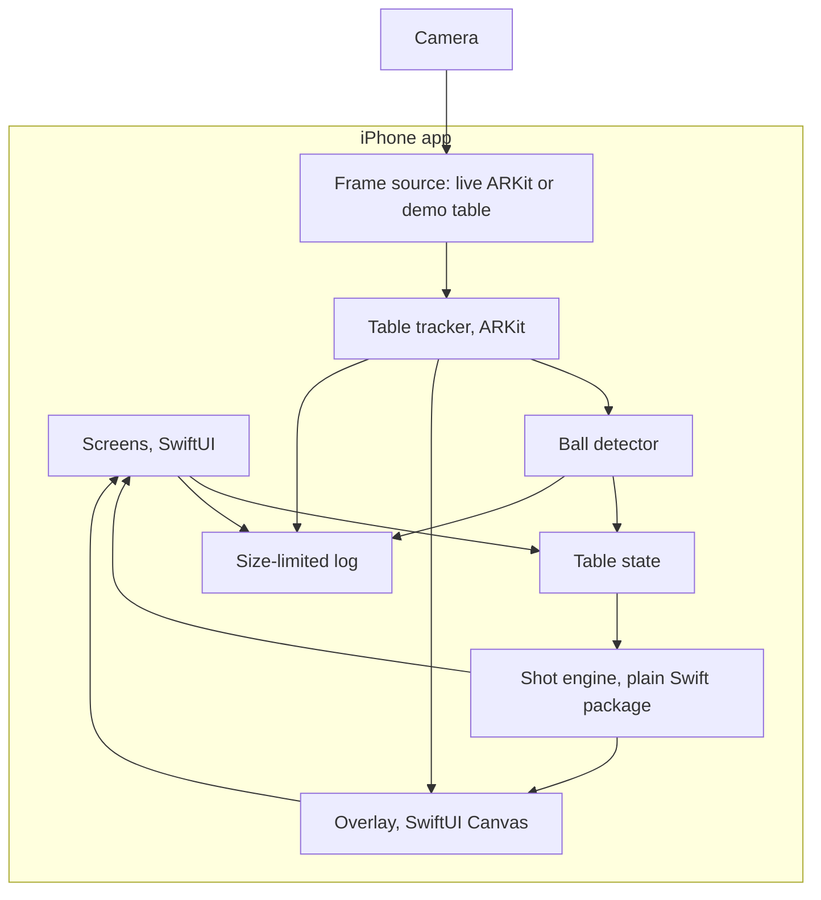
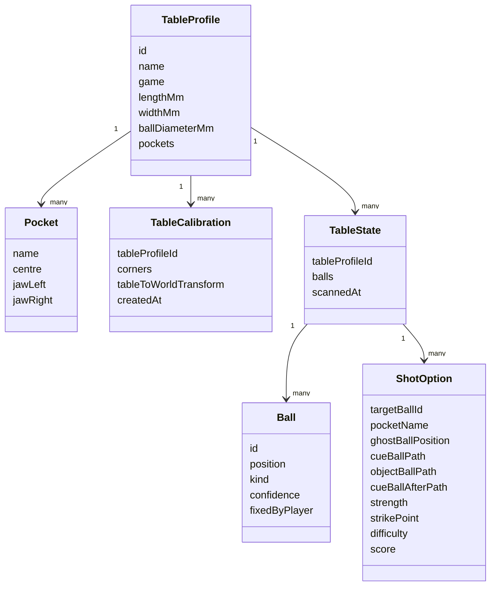

# Design

How CueSight is put together, and why. What's built and what's still to prove is in [ROADMAP.md](ROADMAP.md). The flows are in [LOGICAL-FLOW.md](LOGICAL-FLOW.md).

## Architecture

A native iPhone app. All the work happens on the phone, and there's no server.

| Part | Job |
| --- | --- |
| Screens | Everything the player sees and taps |
| Frame source | Gives the app camera frames and camera details. `LiveFrameSource` uses ARKit, `DemoFrameSource` draws a generated table. |
| Table tracker | Runs ARKit, finds the table from the four corners, and keeps it anchored |
| Ball detector | Finds balls in camera frames and turns them into table positions |
| Table state | Holds the current table and balls, and takes the player's fixes |
| Shot engine | Takes a table state and returns ranked shots. It knows nothing about cameras or AR. |
| Overlay | Projects the table outline, lines and ghost ball through the current camera and draws them in 2D on top |
| Log | Writes events and numbers to a capped file for export |

## Tech stack

| Area | Choice | Why |
| --- | --- | --- |
| Platform | iOS 17 or newer, iPhone 12 or newer | Good cameras and solid ARKit, without shutting out most iPhones |
| Language | Swift | Direct access to AR and camera data |
| Screens | SwiftUI, landscape only | Standard, and quick for a few simple screens. A table is wide, so landscape fits it better. |
| AR tracking | ARKit | Gives camera pose and lens details for each frame |
| AR drawing | 2D lines projected through the ARKit camera, drawn with SwiftUI Canvas | Simple, and the same code draws on the demo table in the Simulator. RealityKit only hosts the camera view. |
| Ball detection | Plain Swift, built for this | Works with no training data and no third-party library. It uses the known table position to look for balls only where they can be. |
| Trained model, if needed | Core ML, with a detector that has a permissive licence, such as YOLOX or Create ML | Runs on the phone. Ultralytics YOLO is out because of its AGPL licence. |
| Shot engine | Plain Swift package | Can be tested on a Mac without a phone |
| Saved data | Small JSON files in the app's storage | Only a few small records, so a database is too much |
| Logging | Capped text file, about 5 MB, with export through the share sheet | It's how problems come back from a phone |
| Tests | XCTest, generated tables from SceneSim, and recorded sessions that can be replayed | The Simulator can't run camera or AR work, so the measuring code is tested on generated scenes on the Mac |

## Coordinates

Everything in the shot engine is on the table, in millimetres:

- The origin is the centre of the playing area
- x runs along the long side, y along the short side, and z up from the cloth
- A ball's centre is always at z equal to its radius

The tracker converts between this and the AR world.

## Data model

Only `TableProfile` is saved between sessions. Calibration, ball positions and shots last for the session.

Standard sizes to begin with. Pool tables vary, so they can be edited:

| Table | Playing area (mm) | Ball diameter (mm) |
| --- | --- | --- |
| 7 ft pool | about 1981 x 991 | 57.15 |
| 8 ft pool | about 2235 x 1118 | 57.15 |
| 9 ft pool | 2540 x 1270 | 57.15 |
| Snooker, Phase 3 | 3569 x 1778 | 52.5 |

## Screens

| Screen | What it does |
| --- | --- |
| First run | Explains camera use, asks permission, and shows the guide and fair play note |
| Start | Choose a table, or add one |
| Table setup | Tap the corners with a zoomed view, then check the outline |
| Scan | Live camera, with coverage feedback and a clear next step |
| Review | Markers on balls, with drag, add, remove and choose cue ball |
| Shots | AR lines, the shot card (strength, difficulty, option 1 of 3), Line up, and Next shot |
| Line up | The same lines seen from behind the cue ball, plus the cue line, the strike dot and one piece of advice at a time |
| Settings | Table sizes, units, export log, privacy, licences, about |

There are no accounts or profiles, so there are no login screens.

## How the shot engine works

Geometry plus enough physics to get speed and the cue ball's path roughly right.

- **Aim:** the ghost ball sits one ball diameter back from the object ball, on the line from the pocket through the object ball.
- **Blocked paths:** a path is blocked if another ball's centre comes within one ball diameter of the line.
- **Shot types:** direct pots, the object ball off one cushion, and the cue ball off one cushion first.
- **Cushions:** the cushion sends the ball back at about three quarters of its speed into it, but a rolling ball keeps some of its roll into the cushion. So it slides for a moment and bends back towards the cushion before it rolls again, and comes off flatter than a mirror bounce. A ball that was just hit is still sliding and has little roll, so it bounces more like a mirror. The bounce point is solved for the ball's real speed and roll when it gets there, and the clear-path check follows the bend. How much roll survives (`cushionSpinKept`) is a guess until it's measured on a real table, so banks and kicks that need finer aim than 0.03 degrees aren't offered.
- **Throw:** on a cut, friction between the balls pushes the object ball slightly off the line. The aim moves to make up for it.
- **Strength:** the object ball starts out sliding and only rolls later, so it needs more speed than rolling alone suggests. The cue ball's start speed is worked out the same way, for the strike that's advised: backspin makes the cue ball lose speed faster while it slides, so draw needs a harder hit than a centre strike. It's grouped as soft, medium or firm.
- **Cue ball after contact:** worked out from the cue ball's speed and spin at contact. Centre, top (follow) or bottom (draw) is picked to keep the cue ball out of pockets. Draw wears off on a long shot, so if every soft option scratches, a firmer draw is tried. On a bank, the cue ball mustn't cross the object ball's way back off the cushion, or the two kiss. If every strike does, the bank isn't offered.
- **Difficulty:** from how far the aim can be off and still pot, in degrees. That covers cut angle, distances and the pocket's opening in one number. It's shown as easy, medium or hard, not a percentage.
- **Cut limit:** cuts past about 75 degrees are rejected.
- **Rules:** none, 8-ball (open, solids, stripes), or snooker (on a red, on a colour, colours in order at the end).
- **Checking the advice:** a separate table simulator plays each advised shot to see if it goes in. It isn't used in the app, only to check the engine.

Side spin, cloth wear, and uneven tables are still ignored.

## Lines on the table

The cue ball's path is white, the object ball's is yellow, and the cue ball after contact is a dashed light blue. They're fixed colours, not the system ones that shift with light and dark mode, and each is drawn over a dark outline (black at 70%). On bright cloth the outline carries the contrast, and on dark cloth the colour does. Contrast against the generated cloth colours, taking whichever of line or outline stands out more, from cloth 40% darker to 30% brighter than normal:

| Cloth | White | Yellow | Light blue |
| --- | --- | --- | --- |
| Green | 4.5 to 9.9 | 3.5 to 7.0 | 3.2 to 5.7 |
| Blue | 5.2 to 12.8 | 3.7 to 9.1 | 3.1 to 7.4 |
| Red | 6.4 to 14.3 | 4.5 to 10.1 | 3.7 to 8.2 |

Everything is above 3 to 1, the usual minimum for lines and shapes. The system cyan used before dropped to 2.7 on red cloth. These are generated cloth colours, so a real cloth under real lights still needs a look. The demo table can be drawn in blue or red with the launch argument `-demoCloth blue` or `-demoCloth red`.

## Lining up

The shot is worked out once, in table coordinates. Lining up only changes where it's seen from.

- `AimGuide` (in ShotEngine, no camera code) takes the shot and gives the aim direction (the first leg of the cue ball's path, so it works for kicks too), the cue line behind the ball, and the strike mark: a point on the back of the cue ball, half a radius above or below the middle for follow or draw.
- The app turns the camera's position and facing into table coordinates, and `AimGuide.reading` says how far behind the ball the phone is, how far off the line, and how far it's turned. The advice comes from that, one thing at a time: get behind, then step sideways, then turn.
- Tolerances are 25 mm sideways and 3 degrees of turn. A phone in hand won't hold better than that, and the lines themselves only need the phone to be roughly behind the ball.
- Close up, the cue line runs back under the phone. Each segment is cut where it passes 5 cm in front of the camera, so nothing behind the phone gets drawn in the wrong place.
- While lining up, lines are drawn at the height of the ball centres rather than on the cloth. From above it makes no difference. From low down behind the ball, it's what you sight along.
- The demo draws the table from a pretend phone 48 cm behind the cue ball and 22 cm up, and a sideways drag moves it.

What isn't known yet: whether ARKit keeps tracking well that low and close to plain cloth, and whether a small error in ball positions looks worse from close up. Both need a real phone at a real table.

## Accessibility

- VoiceOver reads every button and panel. Ball markers on the review screen say what the ball is and where, for example "Solid, near the top left pocket", and open the change or remove panel. On the shots screen, a "Choose a ball" menu appears when VoiceOver is on, because balls can't be tapped on the picture.
- Table setup needs sight: corners are tapped on the camera picture. VoiceOver says so.
- Text follows the system size on the lists and settings. On the camera screens it stops at the largest standard size (before the accessibility sizes), so the panels don't cover the table in landscape.
- Disabled buttons turn grey.

## Performance and privacy

- Detection runs on about 10 frames a second, off the main thread, only while scanning. AR tracking keeps running at full speed.
- Between scans the app only draws. That keeps heat and battery use down, and the balls aren't moving anyway.
- Camera frames are held in memory only as long as they're needed, then dropped.
- The app has no networking code, and it never saves frames. `scripts/privacy_check.sh` checks that, and should be run before every release. Recording test sessions (`SceneRecording`) is only used by the bench tool.

## Key decisions

These can change once the app meets a real table.

**1. iPhone first, native Swift.** ARKit is mature, and the app depends on exact camera data. Unity or a cross-platform framework would add a layer between the app and the thing that matters most. The cost is a rewrite of the AR and screen layers for Android.

**2. No server.** Nothing here needs one. No server means no running costs, no account system, and a much simpler privacy story, and the phone stays useful in a club with bad signal.

**3. Pool first, then snooker.** Pool pockets are more forgiving and the table is smaller, so the phone has the best chance there. Snooker balls are easier to tell apart, but a 12 ft table with tight pockets is the harder accuracy problem.

**4. Four tapped corners plus known table size.** This gives the table's position without relying on ARKit finding a plane, and plain cloth has very little texture for it to lock on to. Automatic corner detection can come later. Tapping is reliable and quick to build.

**5. Scan, then look, not live tracking.** Balls are still while you decide, so one good scan is all that's needed. It's more accurate, because many frames are combined, and it's easier on the battery. The cost is a few seconds of sweeping before each shot.

**6. Correct for ball height.** The camera sees the middle of a ball, about 28 mm above the cloth. At a low viewing angle, treating that point as being on the cloth would put the ball well off its true position.

**7. Classic detection first, trained model only if needed.** Classic image processing needs no dataset, so Phase 0 gives an answer sooner. If it fails in poor light or at low angles, a small model is the first fallback.

**8. The player can fix the scan.** Dragging a marker costs a few seconds. One wrong ball makes all the advice wrong, and no detector is perfect, so this stays even if detection gets very good.

**9. Tap a ball, no rules at first.** The first version doesn't know the game state or which balls are legal. Letting the player choose avoids telling balls apart, and avoids rules logic, and it still answers the main question.

**10. Up to 3 options.** One hides the choice, and more than 3 gets hard to read on the table. The idea talks about options, so one best shot alone isn't enough.

**11. "Win" means the best next shot, for now.** It's something that can actually be built and checked. Planning across a whole frame needs reliable shot results and cue ball control first.

**12. Words for difficulty and strength.** Easy, medium, hard, soft and firm are honest about how much the app knows. Numbers would look more exact than they are.

**13. Hide lines when tracking is bad.** A line in the wrong place is worse than no line, because it looks just as confident.

**14. Phone in hand, then put it away.** It's the simplest setup and needs no gear. A stand could fix occlusion and shake later, but it should only come in if testing shows it's needed.

**15. Shared test cases for the shot engine.** Known inputs and outputs are stored as plain data files. If Android happens, the engine can be ported and checked against the same cases.

**16. Combine frames by how much each one can be trusted.** A ball seen at a low angle is only well placed across the line of sight. Each sighting carries that, and frames from different sides fix each other's weak direction. That's why the scan asks you to walk round.

**17. A spot only counts if it's seen in most frames that can see it.** Cushion edges and pocket rims can look like a ball from one angle. A real ball is found almost every time.

**18. Check that views agree.** A wrong table size doesn't show in the corner fit, because a bigger table further away looks the same. It does make the same ball land in different places from different sides, so the app checks for that and asks you to check the size.

**19. Demo table behind the same interface as the camera.** The whole app can be used and tested in the Simulator, and on a phone without a table. It's clearly labelled as a demo.

**20. The shot finder and the checker share one physics model.** The finder works out aims and speeds with formulas, and a separate simulator steps time forward to check them. Where they disagreed, the finder was wrong about a real effect (backspin costing speed, roll bending a bounce), so the finder was fixed, not the checker. The one number neither can know, how much roll survives a cushion, is a single setting both use, flagged for measuring.

**21. Line up from behind, with one piece of advice at a time.** Seeing the shot from the side is good for choosing it, but you play it from behind the cue ball. The lines are already pinned to the table, so walking behind the ball only needs the cue line, a strike dot and a guide to get on the line. One instruction at a time is easier to follow with a cue in the other hand than a set of numbers.
