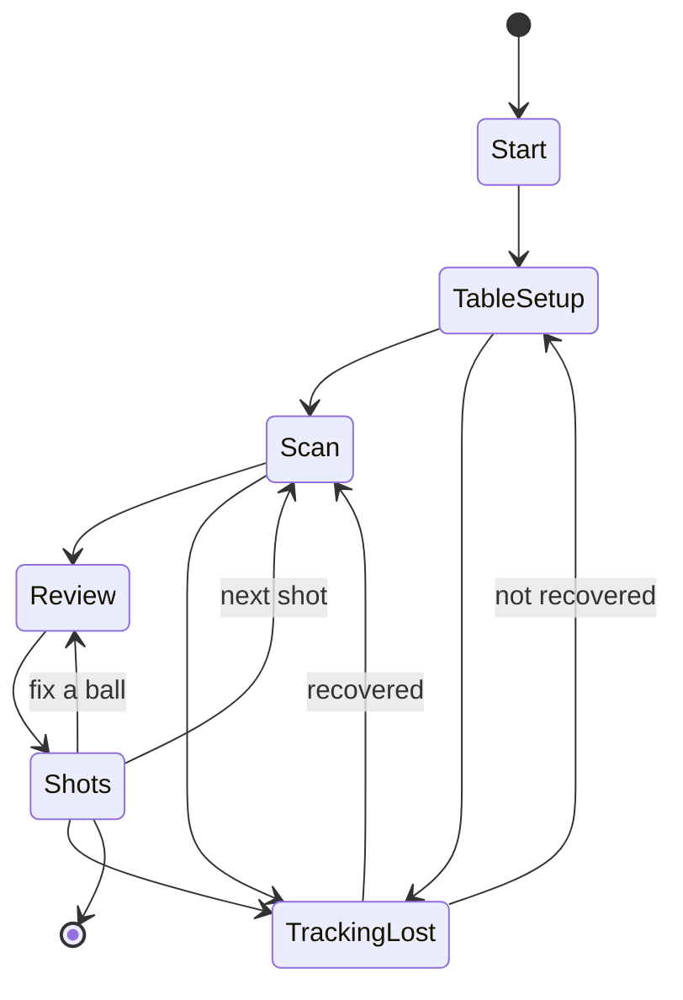
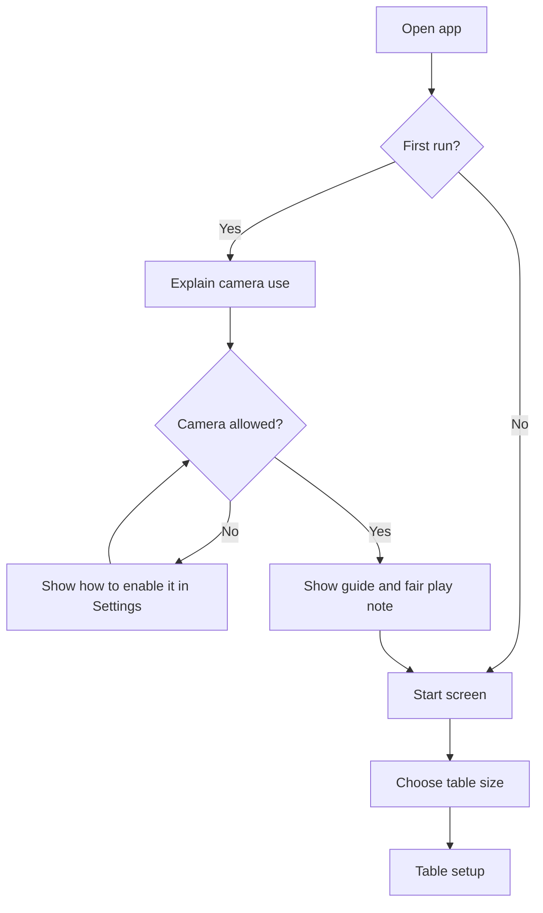
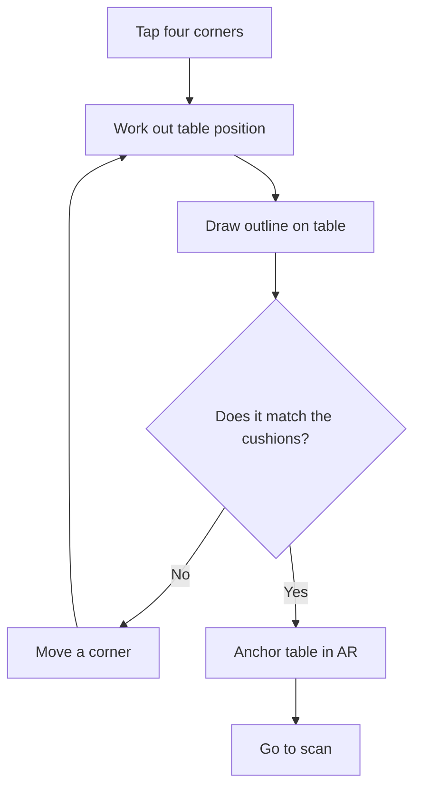
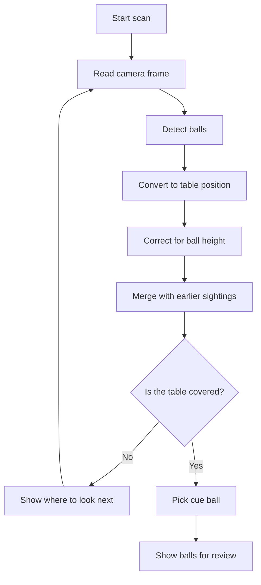
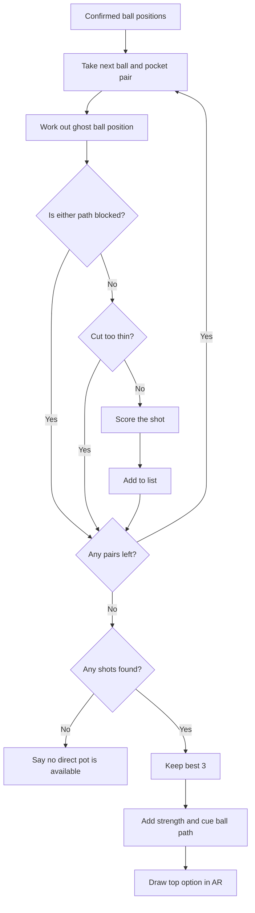
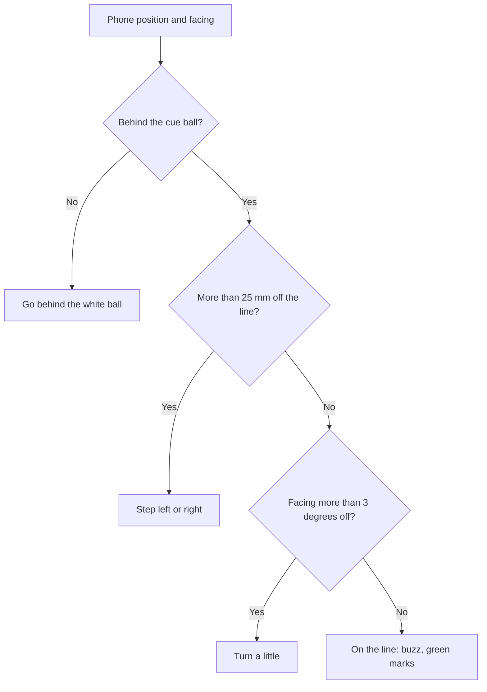
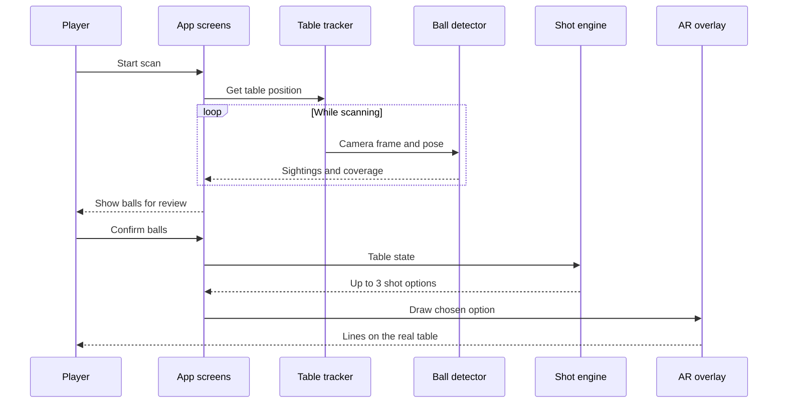
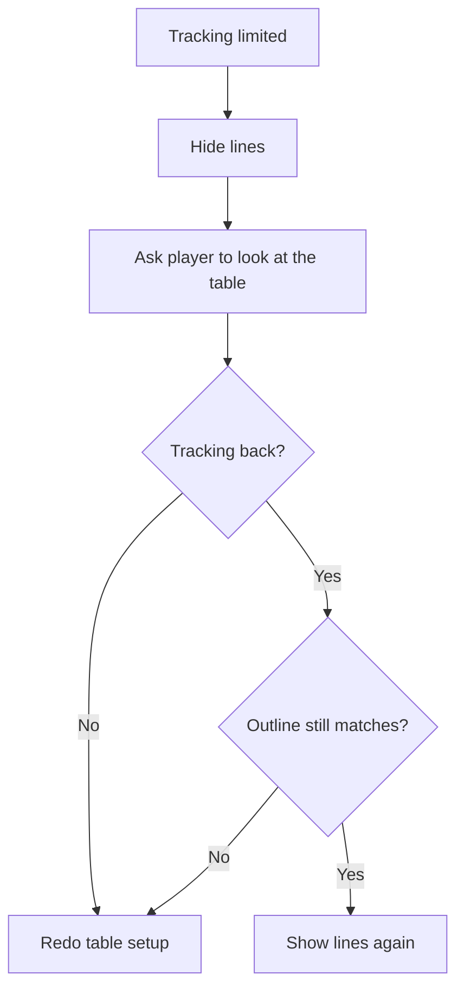

# Logical flow

The main flows for the first small version, described in [ROADMAP.md](ROADMAP.md). The design behind them is in [DESIGN.md](DESIGN.md).

## The whole journey

1. Open the app and choose the table size.
2. Set up the table by tapping its corners.
3. Scan the balls.
4. Fix any mistakes.
5. See the shot options on the table.
6. If you like, walk behind the cue ball and line up with the phone in hand.
7. Put the phone down and play.
8. Rescan for the next shot.

Setup only happens once per table. After that, the loop is scan, look, play.

## 1. First run

1. The app says why it needs the camera, and that images stay on the phone.
2. iOS asks for camera permission.
3. If it's allowed, carry on. If it's denied, show how to turn it on in Settings.
4. Show the short note that lines are a guide and the app is for practice and casual play.
5. Choose the table size, or type in a custom one.

## 2. Table setup

1. The player stands where all four corners can be seen, or walks to each one.
2. The player taps each corner of the playing area, helped by a zoomed view.
3. The app works out the table's position from the four corners and the table's known size.
4. The app draws an outline of the table in AR.
5. The player checks the outline matches the real cushions.
6. If it's off, the player moves a corner or starts again.
7. The app anchors the table in AR, so it stays in place when the phone moves.

## 3. Scan the balls

1. The app waits until the balls have stopped moving.
2. The player sweeps the phone slowly along the table.
3. The app detects balls in each frame and converts them to table positions.
4. It corrects each position for ball height.
5. It combines several sightings of each ball into one position.
6. It shows which parts of the table still need a look. A part counts as covered once it's been seen from two directions at least 120 degrees apart, so the player has to go round to the other side.
7. When the coverage is good enough, the scan ends. The player can also finish early after a few frames.
8. Anything that turned up in fewer than half the frames that could see it is dropped as noise.
9. The app picks the cue ball as the most likely plain white ball.
10. If the same balls land in different places from different sides, the app says the views don't line up and suggests checking the table size.
11. The balls are shown on the table for review.

## 4. Review

1. Each ball appears with a marker on it.
2. Low-confidence balls are highlighted.
3. The player drags a marker to fix it, adds a missing ball, removes a false one, or changes which ball is the cue ball.
4. The player confirms.

Skipping this is allowed when everything looks right. A wrong ball means wrong advice, so the highlight has to be easy to spot.

## 5. Find and show shots

1. The shot engine takes the ball positions, table size and pockets.
2. It looks at every object ball with every pocket. If the player tapped a ball, it only looks at that ball.
3. For each pair it works out where the cue ball must be at contact (the ghost ball).
4. It rejects the shot if another ball blocks either path, or if the cut is too thin.
5. It scores the rest, using cut angle, distances and the angle into the pocket.
6. It keeps the best 3.
7. It works out soft, medium or firm from the total distance.
8. It works out where the cue ball goes after contact.
9. The app draws the top option in AR, and the player can switch between options.

## 6. Line up behind the cue ball

The overview shows the shot from the side. Lining up shows it from where you'll play it.

1. On the shots screen, the player taps Line up.
2. The player walks round behind the cue ball and holds the phone low, pointing along the shot.
3. The lines stay pinned to the table, so they're now drawn from the player's own view. They run through the middle of the balls, the height you sight along.
4. A dashed white line runs back from the cue ball towards the player. That's where the cue goes.
5. A red dot on the back of the cue ball shows where to strike it: the middle, above it for follow, or below it for draw.
6. Many times a second, the app works out where the phone is against the aim line and says one thing:
   - "Go behind the white ball" if the phone is in front of it or well off to the side
   - "Step left" or "Step right", with the distance, if it's more than 25 mm off the line
   - "Turn the phone a little left" or "right" if it faces more than 3 degrees off the line
   - "You're on the line" otherwise. The phone gives a short buzz, the marks at the top and bottom of the screen turn green, and the aim line runs straight up the middle.
7. The player puts the phone down and plays, or taps Done to go back to the overview.

In the demo there's no phone to move, so a sideways drag steps the pretend phone left or right.

## 7. From scan to AR lines

How the parts talk to each other during one round.

## 8. Next shot

1. The player puts the phone down and plays.
2. When the balls stop, the player taps Next shot.
3. The table anchor is still there, so setup isn't needed again.
4. The app does a fresh scan, because the balls have moved.
5. If the table outline no longer matches, the player redoes setup.

The app doesn't watch the shot being played in the first version.

## 9. Tracking lost

AR tracking can drop when the view is blocked, the light is bad, or the phone was put down in a pocket.

1. The app sees that tracking is limited, and hides the lines. Wrong lines are worse than no lines.
2. It asks the player to look at the table again.
3. If tracking comes back and the table anchor holds, the lines return, and the player checks the outline.
4. If not, the player redoes table setup.

## 10. Exporting a log

1. Something goes wrong and the player opens Settings.
2. The player taps Export log.
3. The iOS share sheet opens with the log file.
4. The player sends it wherever they choose.

The log holds app events and measured numbers. It has no images, and it's capped in size, with the oldest lines dropped first.
